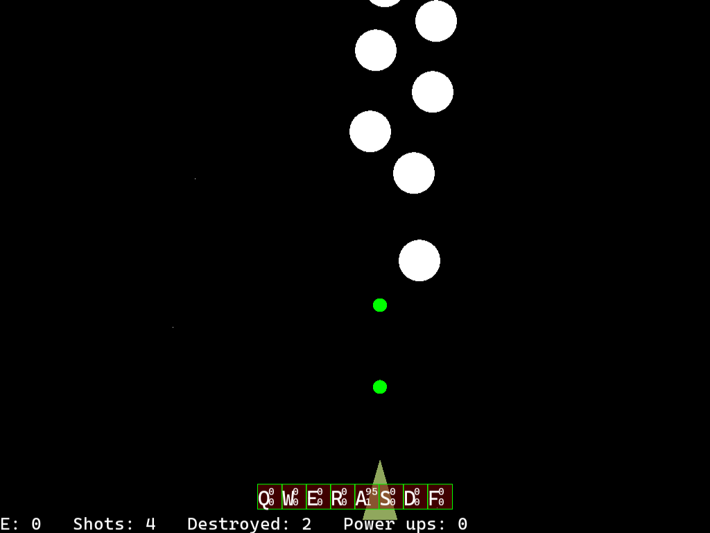

# yips
A vertical space shooter (inspired by B-Wings) with a scenario editor, on SFML, ImGui and kazilib.

**Play it in your browser: https://kazin.dev/projects/yips/**



## Libraries

| Library | Version | Where |
|---------|---------|-------|
| kazilib | master (submodule) | `src/dep/kazilib`: imgui 1.84 + imgui-SFML (SFML 3), magic_enum, nlohmann json 3.12, rang, `stdnames.h`, `under.h`, `initflags.h` (launch flags), `exception_report.h`, Testerino (`testerino/tcore.h`, `tt.js`); built as its `ml` version through `kazilib.vcxproj` |
| SFML | 3.1.0 x86 | `src/dep/SFML-3.1.0`: a junction to `D:\code\kazilib\SFML-3.1.0`, or the official vc17 32-bit release |

## Building

Visual Studio 2026 (v145 toolset).

```
git clone --recurse-submodules https://github.com/xkazinx/yips.git
powershell -ExecutionPolicy Bypass -File build.ps1
```

`build.ps1` runs `setup.ps1` (kazilib submodule, SFML) and builds Release, x86, with the
64-bit-hosted compiler and linker, through kazilib's FASTBuild runner
(`src\dep\kazilib\fastbuild\`, configured by `src\fastbuild.json`: the `.bff` is generated
from the `.vcxproj` files, distributed to the workers that answer; MSBuild when FBuild is
missing) to `deploy\yips.exe`, with SFML's DLLs beside it. Its arguments go to the runner:
`kazilib` / `yips` (both by default), `-Configuration Debug`, `-Regen`, `-Clean`, `-Local`.
`src\yips.sln` opens the same projects in Visual Studio.

## Playing

Run `deploy\yips.exe` (it reads `deploy\data\` beside it, from any working folder).

- **Start:** Enter plays, Ctrl+E opens the scenario editor, Esc exits (from any scene).
- **Scenario:** the arrows move the ship (Shift doubles the speed); Q W E R A S D F use the
  abilities while they have ammo (A fires, 99 shots to start), Ctrl + the key spends an
  energy on its level; O / L add a waving / straight obstacle; F3 the numbers overlay.
  Four obstacles of a type destroyed in a row drop a power up: Energy, Velocity,
  Invincible or ammo (3) for an ability.
- **Editor:** New / Open / Save / Save As / Play Scenario (Ctrl+P plays the scenario being
  edited, saved or not); the Position tool places obstacles where you click, Selection
  toggles them and the Selection tasks align or separate the selected ones (by
  Separation pixels); Up / Down scroll (Shift faster), F1 the menu, F3 the overlay.
  Scenarios are JSON files in `deploy\data\scenario\`.

Launch flags (kazilib `initflags.h`, also from an `init.json` beside the exe):
`title=<text>`, `background` (opens behind the window in use), `testerino=<slot>`,
`catchexceptions` (an exception writes `deploy\exceptions\exception_<pid>.txt` / `.dmp` and
ends the program; without it the report is written and the JIT debugger still gets it).

## Testing (Testerino)

The window is driven through kazilib's test bridge (`src\dep\kazilib\testerino\README.md`):
`testerino=<slot>`, only in a source checkout (`src\yips.sln`). The routines start yips behind
your windows, press keys, click, check the answers and take screenshots:

```
node src\dep\kazilib\testerino\tt.js run src\tests\testerino\play.tt
node src\dep\kazilib\testerino\tt.js run src\tests\testerino\editor.tt
```

Reports in `testerino\reports\`, screenshots in `testerino\client_<slot>\shots\`.
Verbs: `state`, `scene`, `key <k|ctrl+k> [times]`, `hold <key> <ms>`, `down` / `up <key>`,
`click x y`, `obstacle <ahead_px> [wave|linear|still]`, `powerup <PowerUpID> [ahead_px]`,
`editor new|open|save|delete|tool|place|select|task|play|menu`, `shot`, `close`, `quit`; conditions
for `waitfor`: `scene=`, `obstacles`, `power_ups`, `projectiles`, `destroyed`,
`power_ups_taken` (`=`, `>`, `<`). `help` lists them.

## In a web browser

Play at **https://kazin.dev/projects/yips/**. It's the same game and editor, compiled to
WebAssembly (Emscripten) against kazilib's web port (`src\dep\kazilib\web\`, its README).
SFML 3.1's window runs on SDL3 there, its drawing on WebGL2, and ImGui draws through SFML
(kazilib's imgui-SFML, `kazilib_web_imgui`).

- **Keys in a browser:** E (or Ctrl+E) opens the editor, and Esc goes back to the Start
  screen (a page can't exit; Esc while typing in a box stays in the box). Everything
  else works as on Windows.
- **Scenarios** `t1` .. `t3` are preloaded under `/data/scenario`. The editor saves into
  the page's memory (MEMFS), so the saves are lost when the page reloads.
- **Scaled Window** (the default), **Original Size** and **Fullscreen** under the game
  (kazilib `web/shell.html`); the query string holds the launch flags.
- No sound yet (yips has none), and no Testerino bridge in a browser.

```
powershell -ExecutionPolicy Bypass -File build_web.ps1
```

`build_web.ps1` builds `src\CMakeLists.txt` (the web build only; Windows uses
`yips.vcxproj`) into `src\build\web\yips-build\` (`index.html`, `.js`, `.wasm`, `.data`). It uses
the shared web SFML in `D:\code\tools\kazilib-web` (`-WebDeps <folder>`), which
`src\dep\kazilib\web\build_deps.ps1` builds when it's missing, and Emscripten from
`D:\code\tools\emsdk`. `-Jobs N` limits parallel compiles, `-Debug` adds Emscripten's checks.

Test: `src\tests\web\run_web_test.ps1` serves the build to headless Edge (kazilib
`web\tools\browser.js`). It plays a few seconds (obstacles, moving, shooting), then runs
the editor: New with a typed size, four obstacles placed, Save As (typing, Ctrl+A / C / V),
more saves, Open with the wheel scrolling its list, and Ctrl+P plays the result.
`-Url https://kazin.dev/projects/yips/` runs the same steps against the live page.
Screenshots go to `testerino\web\`. `src\tests\web\showcase.json` re-shoots `docs\showcase\`
from the live page (`node src\dep\kazilib\web\tools\browser.js --url https://kazin.dev/projects/yips/ --steps src\tests\web\showcase.json`).

## Deployment

```
powershell -ExecutionPolicy Bypass -File deploy_ubuntu.ps1   # web build, upload, install
```

`deploy_ubuntu.ps1` builds the web version and sends it to the box `kazin-music` with
`deploy\ubuntu\`, where `install.sh` swaps the files into `/opt/yips/web` whole (a
visitor never gets half of two builds). Caddy serves them through
`/etc/caddy/sites/kazin.dev.d/yips.caddy` (`/projects/yips/`, revalidated each visit).
The installer validates the snippet first and restarts Caddy only when the snippet
changed. There's no server or service: yips is single player.
